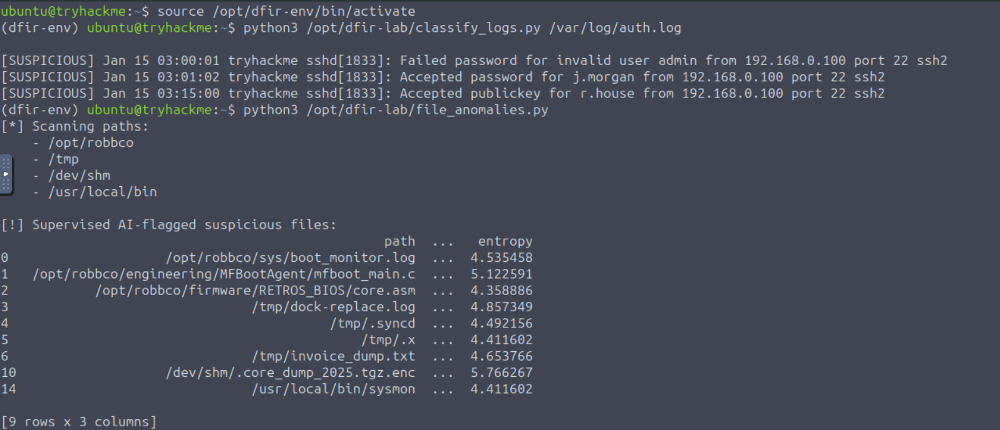

# Stage 01: Initial Triage (`auth.log` & Anomaly Triage)

## 1. Investigation Objective
Activate an isolated analysis environment and run initial triage scripts across authentication logs and sensitive system directories to identify suspicious logins and anomalous files without altering host evidence.

## 2. Evidence Examined
* `/var/log/auth.log` (via `/opt/dfir-env` triage tooling)
* Target directories: `/opt/robbco`, `/tmp`, `/dev/shm`, `/usr/local/bin`

## 3. Linux Commands Used
```bash
source /opt/dfir-env/bin/activate
python3 classify_logs.py
python3 file_anomalies.py
```

## 4. What I Observed
* `classify_logs.py` flagged three authentication events originating from `192.168.0.100`:
  1. `03:00:01` — Failed password attempt for invalid user `admin`.
  2. `03:01:02` — Accepted password login for user `j.morgan`.
  3. `03:15:00` — Accepted public-key login for privileged user `r.house`.
* `file_anomalies.py` flagged 9 files across `/opt/robbco`, `/tmp`, `/dev/shm`, and `/usr/local/bin` exhibiting high entropy or irregular metadata attributes.

## 5. How I Interpreted the Evidence
The sequence of a failed `admin` probe followed one minute later by a successful login for `j.morgan`—and fourteen minutes later by a public-key login for administrative user `r.house`—pointed to initial compromise of `j.morgan` followed by privilege escalation into `r.house`. The flagged files provided concrete starting paths for manual verification.

## 6. Screenshot Evidence

**Evidence ID:** E-01



*Figure E-01. Initial triage output.*

**What this image supports:** The authentication events and anomaly-triage results recorded for the four reviewed paths.

**Evidence boundary:** The screenshot records the displayed triage output. The underlying triage scripts are not included, so their internal detection logic is not independently reviewable.

## 7. What the Finding Established
Established the initial timeline anchors (`03:00:01` to `03:15:00`), identified the two affected user accounts (`j.morgan` and `r.house`), and narrowed manual filesystem inspection to four target directories.

## 8. Evidence Correlation

The authentication-log events provide three time anchors: the failed `admin` attempt at 03:00:01, the accepted `j.morgan` password login at 03:01:02, and the accepted `r.house` public-key login at 03:15:00. These events establish the authentication sequence. The file-anomaly output identified locations for manual review, but the triage scripts' source code is not included, so their internal detection logic is outside this project's scope.
