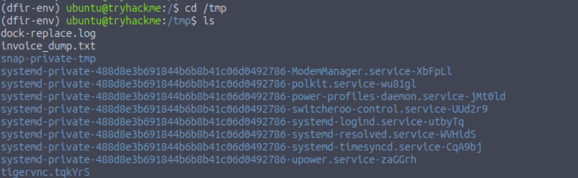

# Stage 02: Temporary-File Investigation (`/tmp`)

## 1. Investigation Objective
Inspect the `/tmp` directory to identify non-standard or attacker-staged files flagged during initial anomaly triage.

## 2. Evidence Examined
* `/tmp` directory listing

## 3. Linux Commands Used
```bash
cd /tmp
ls
```

## 4. What I Observed
Alongside standard system service sockets and directories, two non-standard files were present in `/tmp`:
* `dock-replace.log`
* `invoice_dump.txt`

## 5. How I Interpreted the Evidence
World-writable temporary directories like `/tmp` are commonly used to stage reconnaissance output and scripts. `invoice_dump.txt` stood out immediately as a non-system artifact warranting direct inspection.

## 6. Screenshot Evidence

**Evidence ID:** E-02



*Figure E-02. Temporary-directory listing.*

**What this image supports:** The presence of `dock-replace.log` and `invoice_dump.txt` in `/tmp`.

**Evidence boundary:** A directory listing establishes presence and names only. It does not identify who created the files or prove execution or transfer.

## 7. What the Finding Established
Confirmed the presence of staged artifact `/tmp/invoice_dump.txt` for content analysis in Stage 03.

## 8. Evidence Correlation

The directory listing identified `invoice_dump.txt` as an artifact for the next stage. Stage 03 examines its contents. The listing alone establishes the file's presence in `/tmp`, not who created it or whether its contents were transmitted.
