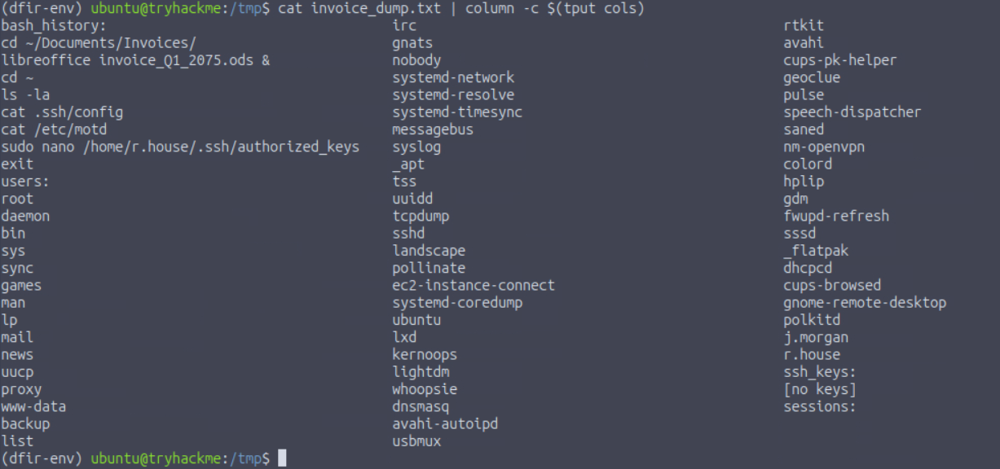

# Stage 03: Reconnaissance Analysis (`invoice_dump.txt`)

## 1. Investigation Objective
Examine `/tmp/invoice_dump.txt` to determine what data was collected and how the file was generated.

## 2. Evidence Examined
* `/tmp/invoice_dump.txt`

## 3. Linux Commands Used
```bash
cat invoice_dump.txt | column -c $(tput cols)
```

## 4. What I Observed
`/tmp/invoice_dump.txt` contained structured reconnaissance output, including:
* Enumerated system usernames (`root`, `ubuntu`, `j.morgan`, `r.house`, and others).
* A captured `.bash_history` block showing the following sequence of commands:
  ```bash
  cd ~/Documents/Invoices/
  libreoffice invoice_Q1_2075.ods &
  cd ~
  ls -la
  cat .ssh/config
  cat /etc/motd
  sudo nano /home/r.house/.ssh/authorized_keys
  exit
  ```

## 5. How I Interpreted the Evidence
The file was generated by an automated host-enumeration routine that dumped user accounts and shell history. Crucially, the captured command history linked two major events: opening `invoice_Q1_2075.ods` via LibreOffice and using `sudo nano` to edit `/home/r.house/.ssh/authorized_keys`.

## 6. Screenshot of the Actual Investigation


## 7. What the Finding Established
Identified `invoice_Q1_2075.ods` as the suspected execution trigger and uncovered direct evidence of `sudo` abuse targeting `r.house`'s SSH `authorized_keys` file.

## 8. Evidence Correlation

The captured command history in `invoice_dump.txt` is compared with the local `/home/j.morgan/.bash_history` in Stage 07. Both contain the invoice-opening command and the `sudo nano /home/r.house/.ssh/authorized_keys` command. The attachment inspected in Stage 04 contains commands that write reconnaissance data to this output file, linking the observed contents to the suspected attachment. These correlations do not independently establish successful network transfer.
