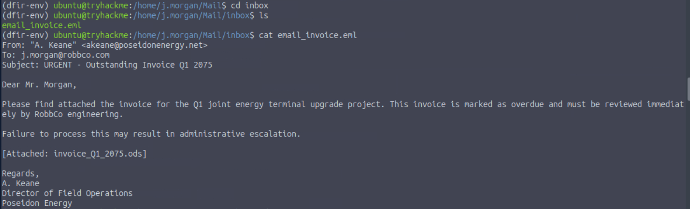

# Stage 05: Phishing Email Investigation (`email_invoice.eml`)

## 1. Investigation Objective
Examine `j.morgan`'s local mail directory to verify how `invoice_Q1_2075.ods` was delivered to the host.

## 2. Evidence Examined
* `/home/j.morgan/Mail/inbox/email_invoice.eml`

## 3. Linux Commands Used
```bash
cd /home/j.morgan/Mail
cd inbox
ls
cat email_invoice.eml
```

## 4. What I Observed
Inside `/home/j.morgan/Mail/inbox/`, I located `email_invoice.eml` with the following headers and lure content:
* **Sender:** `"A. Keane" <akeane@poseidonenergy.net>`
* **Recipient:** `j.morgan@robbco.com`
* **Subject:** `URGENT - Outstanding Invoice Q1 2075`
* **Attachment:** `invoice_Q1_2075.ods`
* **Body Lure:** Claimed an overdue invoice for the "joint energy terminal upgrade project" required immediate engineering review under threat of administrative escalation.

## 5. How I Interpreted the Evidence
The email headers, attachment filename, and urgent social-engineering pretext matched the exact file (`invoice_Q1_2075.ods`) later opened from `~/Documents/Invoices/`.

## 6. Screenshot Evidence

**Evidence ID:** E-05



*Figure E-05. Phishing email.*

**What this image supports:** The sender, recipient, subject, lure text, and attachment name recorded in `email_invoice.eml`.

**Evidence boundary:** The email artifact supports the recorded message details. It does not by itself prove that the recipient opened the attachment.

## 7. What the Finding Established
Confirmed spear-phishing via email (`email_invoice.eml`) as the initial access delivery mechanism targeting user `j.morgan`.

## 8. Evidence Correlation

The email's attachment name, `invoice_Q1_2075.ods`, matches the file path in the captured shell history and the attachment examined in Stage 04. The sender, recipient, subject, and lure text are taken from the local `email_invoice.eml` artifact. This supports the phishing-delivery narrative without relying on the email's appearance alone.
