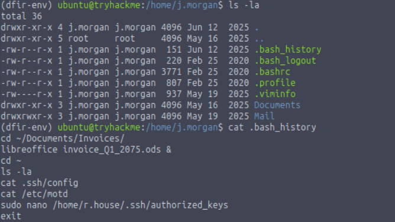

# Stage 07: Privilege Escalation Verification (`.bash_history`)

## 1. Investigation Objective
Correlate the shell commands observed inside `/tmp/invoice_dump.txt` against `j.morgan`'s actual `.bash_history` file to verify how the attacker escalated privileges to `r.house`.

## 2. Evidence Examined
* `/home/j.morgan/.bash_history`

## 3. Linux Commands Used
```bash
cd /home/j.morgan
ls -la
cat .bash_history
```

## 4. What I Observed
`j.morgan`'s `.bash_history` contained the exact command sequence:
```bash
cd ~/Documents/Invoices/
libreoffice invoice_Q1_2075.ods &
cd ~
ls -la
cat .ssh/config
cat /etc/motd
sudo nano /home/r.house/.ssh/authorized_keys
exit
```

## 5. How I Interpreted the Evidence
No kernel or binary exploit was required. After inspecting `.ssh/config` and `/etc/motd`, the attacker abused `j.morgan`'s existing `sudo` privileges to run `nano` on `/home/r.house/.ssh/authorized_keys`, appending an attacker-controlled SSH public key. This directly accounts for the `03:15:00` accepted public-key login for `r.house` recorded in `/var/log/auth.log`.

## 6. Screenshot Evidence

**Evidence ID:** E-07



*Figure E-07. Shell-history SSH command.*

**What this image supports:** The `sudo nano /home/r.house/.ssh/authorized_keys` command recorded in `j.morgan`'s shell history.

**Evidence boundary:** History supports that the command was recorded. The repository does not include before-and-after key-file contents or a key fingerprint.

## 7. What the Finding Established
Verified that privilege escalation from `j.morgan` to administrative user `r.house` occurred via `sudo` abuse and unauthorized modification of `/home/r.house/.ssh/authorized_keys`.

## 8. Evidence Correlation

The command `sudo nano /home/r.house/.ssh/authorized_keys` appears in the captured history inside `invoice_dump.txt` and in the local `/home/j.morgan/.bash_history`. The authentication-log triage in Stage 01 records an accepted public-key login for `r.house` at 03:15:00. The sequence is consistent with SSH key modification followed by public-key access. The repository does not contain the authorized-keys file before and after the command or the key fingerprint, so those details cannot be independently compared here.
