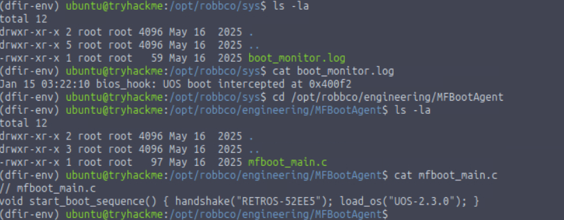

# Stage 09: Persistence Deception & Source-Code Access (`mfboot_main.c`)

## 1. Investigation Objective
Inspect the flagged files under `/opt/robbco` to investigate the fabricated telemetry log and verify whether proprietary engineering source code had been accessed.

## 2. Evidence Examined
* `/opt/robbco/sys/boot_monitor.log`
* `/opt/robbco/engineering/MFBootAgent/mfboot_main.c`

## 3. Linux Commands Used
```bash
cd /opt/robbco/sys
ls -la
cat boot_monitor.log

cd /opt/robbco/engineering/MFBootAgent
ls -la
cat mfboot_main.c
```

## 4. What I Observed
* `/opt/robbco/sys/boot_monitor.log` contained a single fabricated entry:
  ```text
  Jan 15 03:22:10 bios_hook: UOS boot intercepted at 0x400f2
  ```
* `/opt/robbco/engineering/MFBootAgent/mfboot_main.c` was intact and readable, containing proprietary C source code implementing `start_boot_sequence()` and referencing `RETROS-52EE5` and `UOS-2.3.0`.

## 5. How I Interpreted the Evidence
The fake `boot_monitor.log` entry was planted to provide a plausible cover story for `/usr/local/bin/sysmon`. Meanwhile, manual inspection proved that `mfboot_main.c`—which had been flagged by the anomaly script—was legitimate proprietary RobbCo firmware code rather than malware, indicating it was a target of intellectual property theft.

## 6. Screenshot of the Actual Investigation


## 7. What the Finding Established
Confirmed the deception artifact supporting `/usr/local/bin/sysmon` and identified the targeted proprietary source code repository (`/opt/robbco/engineering/MFBootAgent/`).
