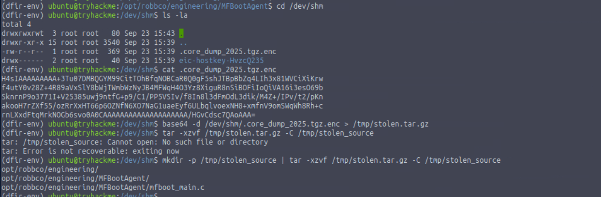

# Stage 10: Shared-Memory Staging & Archive Recovery (`.core_dump_2025.tgz.enc`)

## 1. Investigation Objective
Examine the high-entropy hidden file flagged in `/dev/shm`, decode its contents, and extract the archive to determine whether proprietary source code was packaged for exfiltration.

## 2. Evidence Examined
* `/dev/shm/.core_dump_2025.tgz.enc`

## 3. Linux Commands Used
```bash
cd /dev/shm
ls -la
cat .core_dump_2025.tgz.enc
base64 -d /dev/shm/.core_dump_2025.tgz.enc > /tmp/stolen.tar.gz
mkdir -p /tmp/stolen_source && tar -xzvf /tmp/stolen.tar.gz -C /tmp/stolen_source
```

## 4. What I Observed
* `/dev/shm` contained a hidden file named `.core_dump_2025.tgz.enc` holding a continuous Base64-encoded string.
* Decoding the file with `base64 -d` produced a valid gzip-compressed tar archive (`/tmp/stolen.tar.gz`).
* Extracting the archive into `/tmp/stolen_source` recovered the following directory tree and file:
  * `opt/robbco/engineering/`
  * `opt/robbco/engineering/MFBootAgent/`
  * `opt/robbco/engineering/MFBootAgent/mfboot_main.c`

## 5. How I Interpreted the Evidence
The attacker disguised a compressed archive as a system core dump (`.core_dump_2025.tgz.enc`) and staged it in volatile shared memory (`/dev/shm`) to avoid standard disk monitoring. Decoding and extracting the archive proved that RobbCo's proprietary bootloader source code (`mfboot_main.c`) was packaged and staged for exfiltration.

## 6. Screenshot Evidence

**Evidence ID:** E-10



*Figure E-10. Shared-memory archive recovery.*

**What this image supports:** The encoded archive in `/dev/shm` and the recovered `MFBootAgent/mfboot_main.c` path after extraction.

**Evidence boundary:** The recovered path establishes local archive staging. No packet capture or receiving-listener log confirms external transmission.

## 7. What the Finding Established
Provided concrete, recovered proof of source-code staging (`opt/robbco/engineering/MFBootAgent/mfboot_main.c`) inside `/dev/shm/.core_dump_2025.tgz.enc`.

## 8. Evidence Correlation

Stage 09 identifies `/opt/robbco/engineering/MFBootAgent/mfboot_main.c` as a readable source file. The extracted archive contains the corresponding `opt/robbco/engineering/MFBootAgent/mfboot_main.c` path. This supports the conclusion that the source file was packaged and staged locally in the encoded archive. No packet capture or receiving-listener log is included to confirm that the archive was transmitted outside the host.
